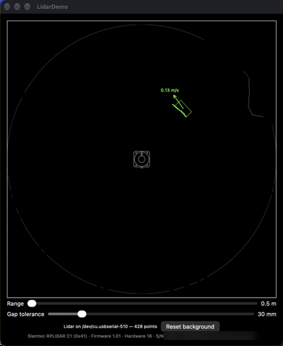
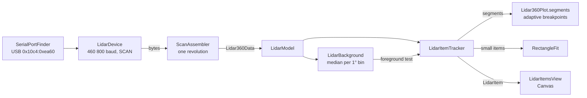

<p align="center">
  
</p>

# LidarDemo

> _Live 2D lidar scans on macOS, with object tracking, speed and a fitted rectangle._

LidarDemo is a macOS app that reads live scans from a Slamtec RPLIDAR C1 over USB serial and plots them in a SwiftUI window. It splits each scan into separate surfaces, learns the static room, and gives each new object its own colour. For each object, it draws an arrow that shows its direction and speed. For a small object with a known 59 × 29 mm cross section, it also fits a rectangle that shows the object's orientation. All the processing is in Swift, with no lidar SDK, and the protocol and tracking code has unit tests. The app supports only the RPLIDAR C1, and the lidar must not move.

<!-- 🖊 TODO: Set project status — delete the others:
> **Status:** Active development — behaviour and tuning values may change.
> **Status:** Experimental / proof-of-concept — use at your own risk.
-->

---

## Table of Contents

- [Features](#features)
- [Prerequisites](#prerequisites)
- [Installation](#installation)
- [Quick Start](#quick-start)
- [Controls](#controls)
- [Tuning](#tuning)
- [How It Works](#how-it-works)
- [Known Limitations](#known-limitations)
- [Contributing](#contributing)
- [License](#license)

---

## Features

- **Finds the lidar automatically.** The app looks for the C1's USB to UART bridge by its USB vendor and product IDs (`0x10c4:0xea60`). If it cannot find the bridge, it tries again every 2 seconds. You do not have to select a port.
- **Separate surfaces, not one polygon.** Adaptive breakpoint detection (Borges & Aldon, 2004) starts a new line where there is a jump between adjacent points. The permitted jump increases with range.
- **Background subtraction.** The app learns the usual range at each 1° bin, so walls and furniture show dim and only new objects get a colour. An object that stays in one place becomes background after approximately 15 seconds.
- **Stable colours.** Objects are matched from scan to scan by their predicted position. An object that is missing for less than 1 second, or that breaks into parts, keeps its colour.
- **Speed arrows.** Each moving object has an arrow to where it will be in 0.5 s, with its speed in m/s.
- **Rectangle fit.** The app fits a 59 × 29 mm rectangle to small objects from the one or two faces that the lidar sees. It smooths the fit from scan to scan.
- **Fixed, adjustable range.** The plot scale does not change when an object comes near. Points beyond the range show dim at the edge.
- **Device info.** The app shows the make, model, firmware, hardware and serial number from the lidar's `GET_INFO` reply.

---

## Prerequisites

- **Mac** with **macOS 14.5** or later (deployment target).
- **Xcode 27.2** or later. The project was last built with Xcode 27.2 and the macOS 27.2 SDK. <!-- 🖊 TODO: confirm the oldest Xcode version that builds the project -->
- **Slamtec RPLIDAR C1** connected over USB. In testing, the macOS built-in driver made the port `/dev/cu.usbserial-510`, and no extra driver was necessary.

---

## Installation

```sh
git clone https://github.com/PeteRichardson/LidarDemo.git
open LidarDemo/LidarDemo.xcodeproj
```

Select the `LidarDemo` scheme and **My Mac**, then press ⌘R.

The project uses automatic signing with the author's development team. To build on your Mac, select your own team in **Signing & Capabilities** for the `LidarDemo` target.

Command line:

```sh
xcodebuild -project LidarDemo.xcodeproj -scheme LidarDemo -configuration Release build
```

The app sandbox is off (`ENABLE_APP_SANDBOX = NO`), because the app must open a serial device in `/dev`.

---

## Quick Start

1. Connect the RPLIDAR C1 and start the app. The window opens at 700 × 700 points, with a range of 0.5 m.
2. The status line shows `Lidar on /dev/cu.usbserial-… — N points` when the app reads scans. If it shows `Lidar not connected (USB 0x10c4:0xea60)`, the app did not find the lidar.
3. Do not move the lidar. The first scan becomes the background, so the room shows dim white.
4. Put an object near the lidar. It shows in a bright colour. When it moves, an arrow shows its speed and direction.
5. If you move the lidar, click **Reset background**.

The drawing at the centre of the plot is the lidar, seen from above. Its arrow points to 0°, at the top of the plot. Angles increase clockwise.

---

## Controls

| Control | Effect | Range | Default |
|---------|--------|-------|---------|
| **Range** slider | Distance from the lidar to the edge of the plot | 0.5–12 m | 0.5 m |
| **Gap tolerance** slider | Extra gap permitted between neighbours on one surface. Larger values join more points into one item. | 0–200 mm | 30 mm |
| **Reset background** button | Forgets the background and learns it again from the current scan | — | — |

The app has no menu commands or keyboard shortcuts of its own.

---

## Tuning

The app has no settings file. The values below are constants in the source.

| Constant | Value | Effect |
|----------|-------|--------|
| `LidarBackground.marginMM` | 50 mm | A reading must be this much nearer than the background to be foreground. |
| `LidarBackground.sampleCount` | 30 | Samples for each bin. An object becomes background after more than half of them. |
| `LidarBackground.scansPerSample` | 10 | Scans between two background samples (approximately 1 second). |
| `LidarItemTracker.matchRadiusMM` | 60 mm | Match distance from an item's predicted position. |
| `LidarItemTracker.maxSpeedChangeMMPerSecond` | 200 mm/s | Increase of the match distance for each second since the item was last seen. |
| `LidarItemTracker.partGapMM` | 100 mm | A left-over part this near to an item joins that item. |
| `LidarItemTracker.maxMissingSeconds` | 1 s | How long a missing item keeps its colour. |
| `LidarItemTracker.velocitySmoothing` | 0.3 | Weight of the newest speed measurement. |
| `LidarItemTracker.rectangleSmoothing` | 0.3 | Weight of the newest rectangle fit. |
| `RectangleFit.lengthMM`, `widthMM` | 59 mm, 29 mm | Cross section of the tracked object. |
| `LidarItemsView.arrowSeconds` | 0.5 s | The arrow points to where the item will be after this time. |
| `LidarItemsView.minArrowSpeed` | 100 mm/s | Slower items have no arrow. |
| `Lidar360Plot.minSurfaceAngle` | 10° | A surface that is more nearly parallel to the beam breaks into points. |

---

## How It Works



- `RPLidarProtocol.swift` has the request packets, response descriptors and the decoder for 5-byte SCAN nodes. It does no I/O.
- `LidarDevice.swift` reads the port on its own thread and sends the `GET_INFO` reply, then one `Lidar360Data` for each revolution (approximately 10 each second).
- `LidarModel.swift` keeps the latest scan, learns the background, and updates the items for each scan.
- `Lidar360Plot.swift` has the segmentation, the tracker and the `Canvas` view.
- `RectangleFit.swift` tries 180 orientations. For each one, it puts the faces on the lidar side onto the nearest points, and keeps the fit with the smallest error.

---

## Known Limitations

- **RPLIDAR C1 only.** The app finds the lidar by the CP2102N USB IDs, uses 460 800 baud and the standard `SCAN` command. It shows a model name only for model code `0x41`.
- **The lidar must not move.** Background subtraction expects a fixed lidar. After you move it, click **Reset background**.
- **One object size.** The rectangle fit uses a fixed 59 × 29 mm cross section, and only items with all points within 63 mm of their mean get a rectangle.
- **Orientation is ambiguous by 180°.** The rectangle looks the same after a half turn, so the app cannot tell the front of the object from the back.
- **Range noise.** The C1's range noise is as large as the small object, so the rectangle needs approximately 0.5 s to settle.
- **Fast objects can change colour.** An object that suddenly moves faster than approximately 0.8 m/s does not match its previous position.
- **Close objects can share a colour.** Two objects that come within 100 mm of each other can join into one item.
- **Stationary objects disappear.** An object that stays for more than approximately 15 seconds becomes background and shows dim.
- **Previews and tests do not use the lidar.** When Xcode Previews or the unit tests launch the app, it does not open the serial port. The preview shows sample data.

<!-- 🖊 TODO: Review and expand. -->

---

## Contributing

Build with ⌘B and run the tests with ⌘U, or:

```sh
xcodebuild test -project LidarDemo.xcodeproj -scheme LidarDemo -destination 'platform=macOS'
```

The tests use the Swift Testing framework and are in `LidarDemoTests/LidarDemoTests.swift`. They cover the protocol decoder, the scan assembler, segmentation, background subtraction, tracking and the rectangle fit. They do not need a lidar.

Commit messages use the `type(scope): subject` format, for example `feat(plot): …` or `fix(ui): …`.

---

## License

Licensed under the **MIT License** — see [LICENSE](LICENSE) for details.
